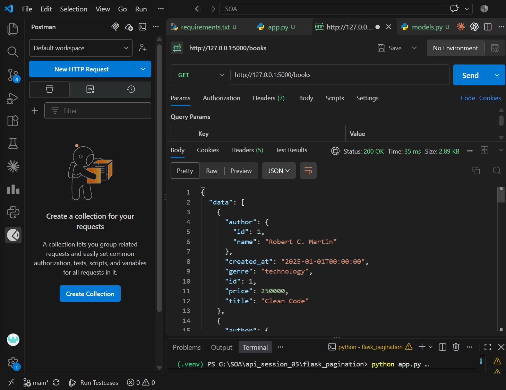
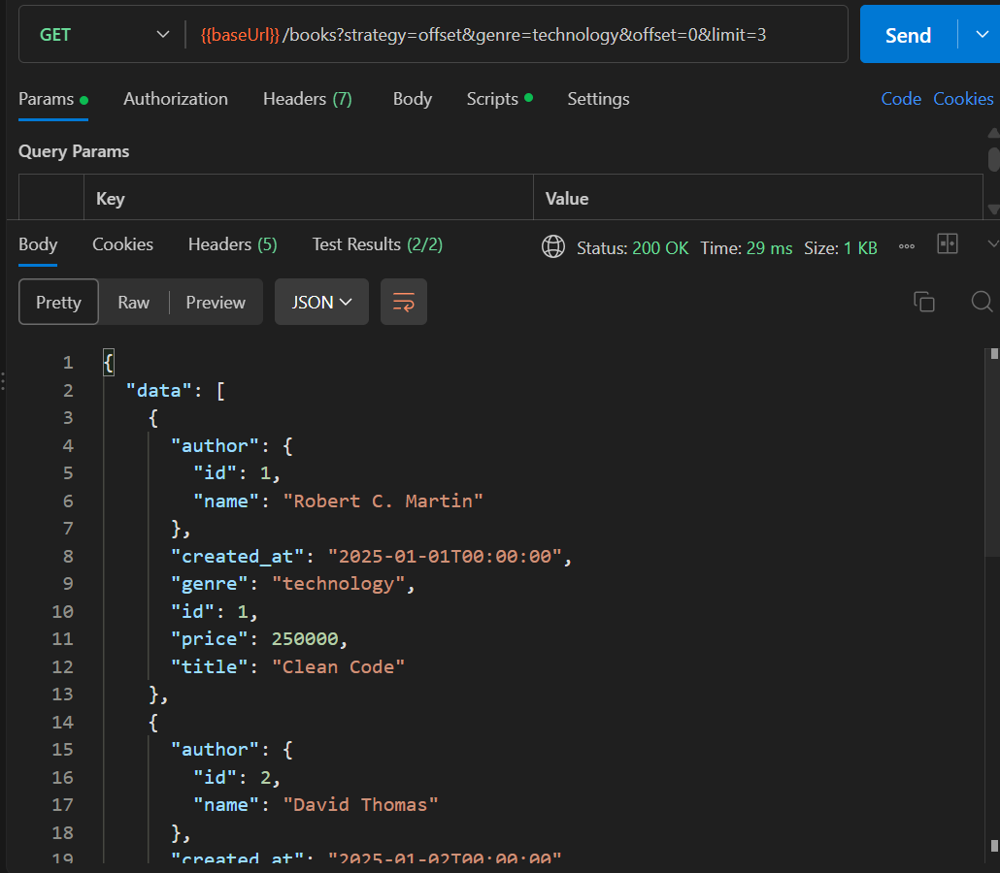
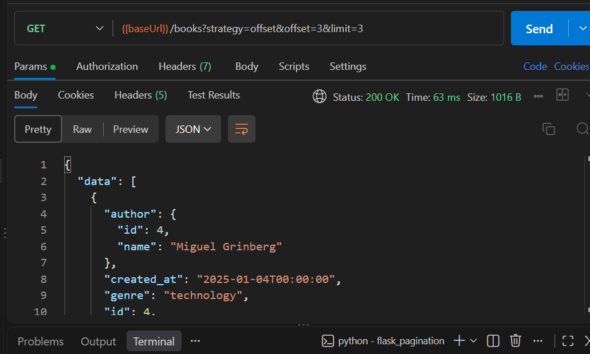
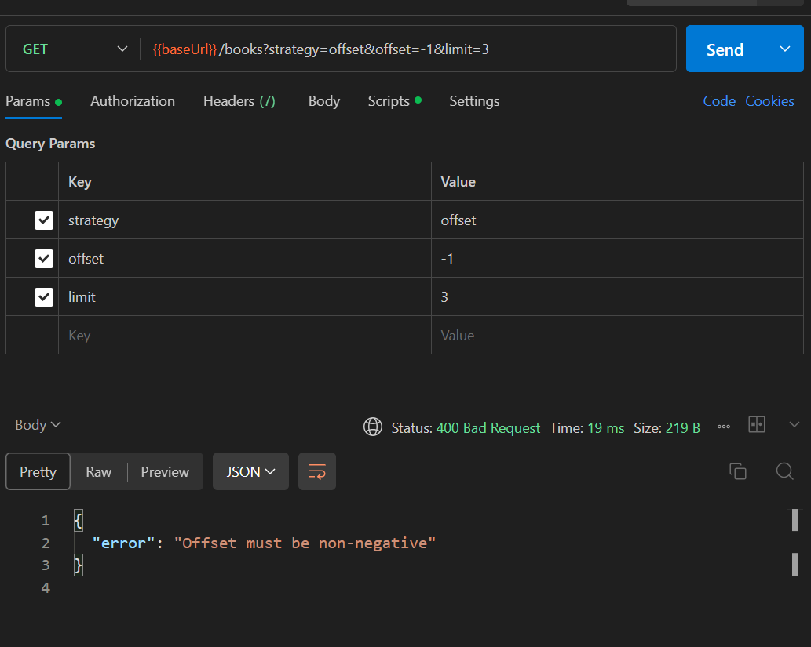
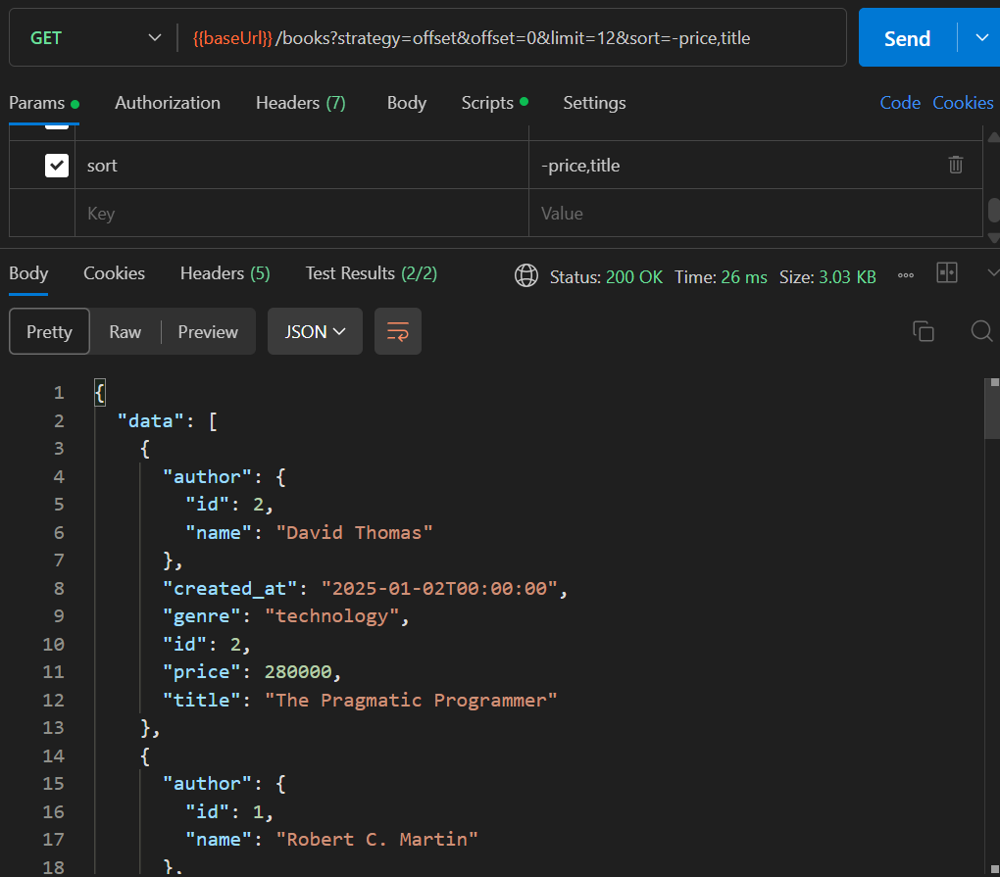
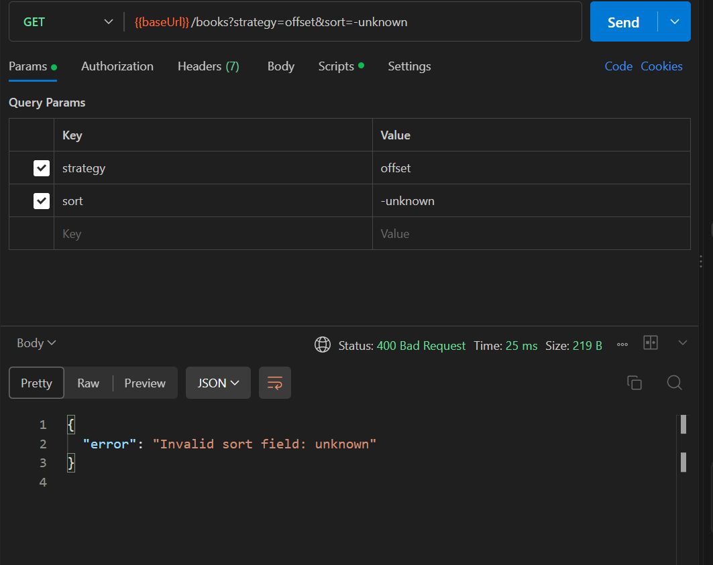
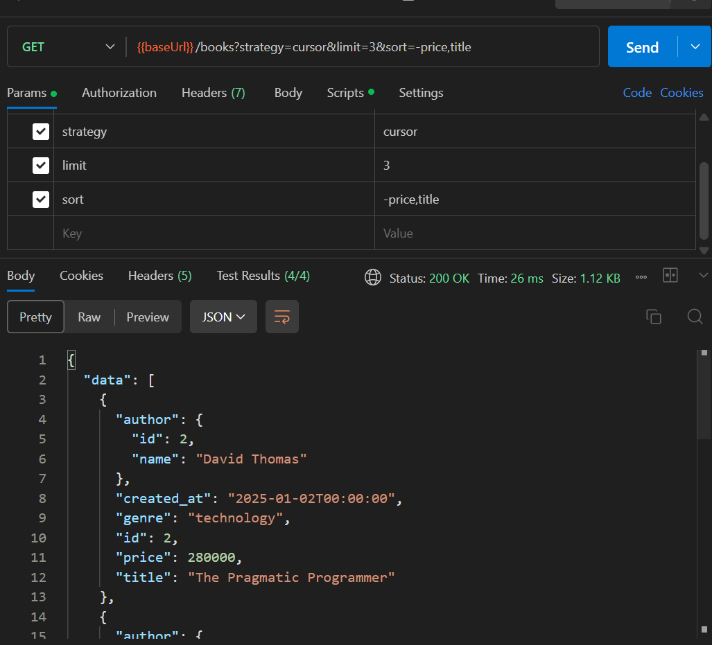
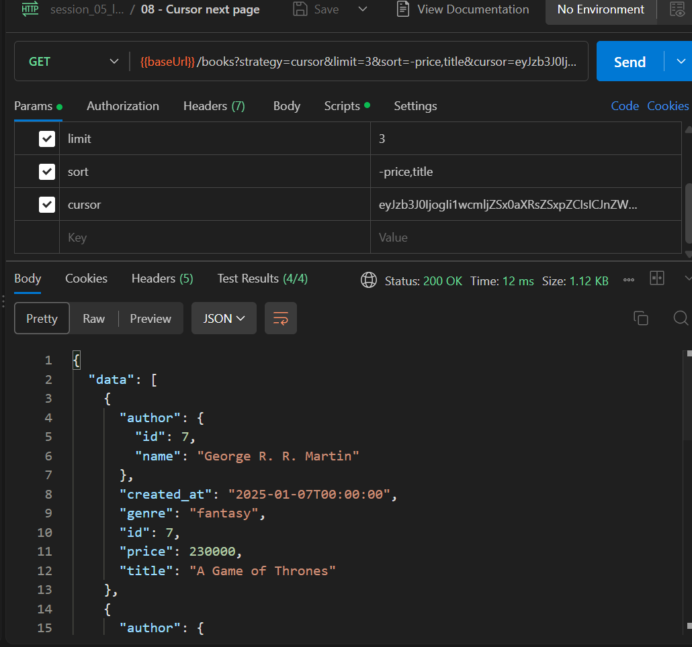
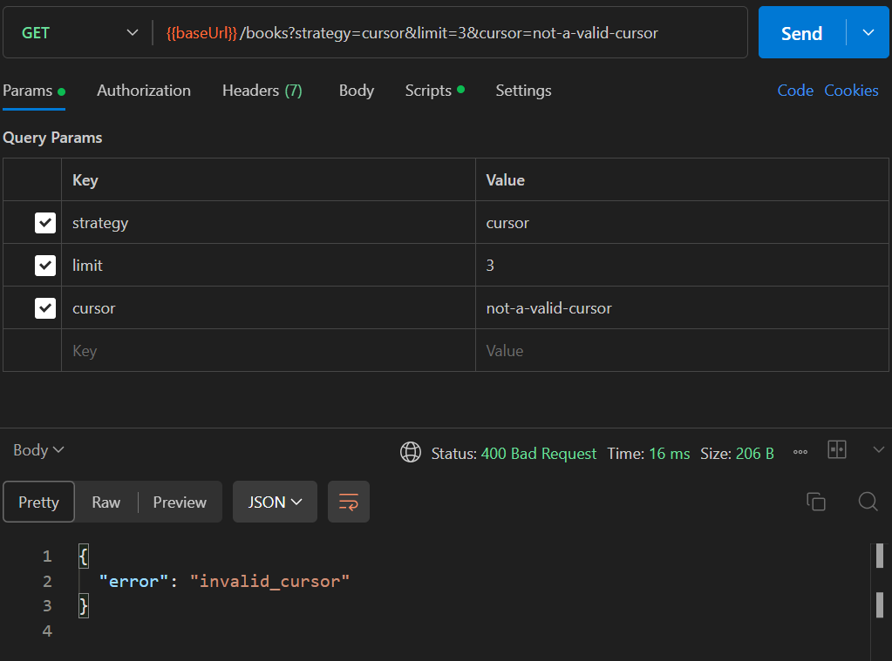
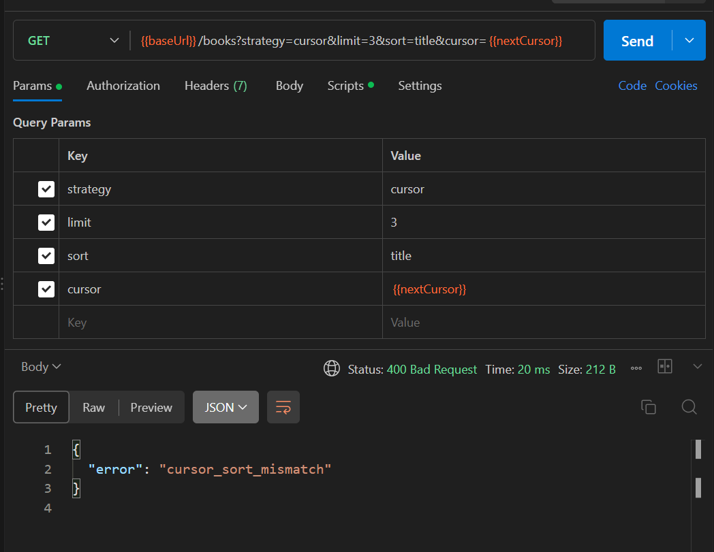

# Flask API Pagination

API minh họa phân trang danh sách sách bằng hai chiến lược `offset` và `cursor`, đồng thời hỗ trợ lọc theo thể loại và sắp xếp theo nhiều trường.

## Chạy ứng dụng

Từ thư mục `G:\SOA`:

```powershell
.\.venv\Scripts\Activate.ps1
cd .\api_session_05\flask_pagination
pip install -r requirements.txt
python app.py
```

API được chạy tại `http://127.0.0.1:5000`. Endpoint dùng để kiểm thử là `GET /books`.

## Kết quả kiểm thử

### 1. Lấy danh sách sách



*Gọi `GET /books` thành công và nhận danh sách sách cùng thông tin tác giả.*

### 2. Lọc sách theo thể loại



*Lọc các sách thuộc thể loại `technology` bằng tham số `genre=technology`.*

### 3. Phân trang bằng offset



*Dùng `offset=3&limit=3` để bỏ qua ba bản ghi đầu và lấy ba bản ghi tiếp theo.*

### 4. Kiểm tra offset không hợp lệ



*API trả về `400 Bad Request` khi `offset=-1` vì offset không được là số âm.*

### 5. Sắp xếp theo nhiều trường



*Sắp xếp giảm dần theo `price`, sau đó tăng dần theo `title` với `sort=-price,title`.*

### 6. Kiểm tra trường sắp xếp không hợp lệ



*API trả về `400 Bad Request` khi yêu cầu sắp xếp theo trường không được hỗ trợ `unknown`.*

### 7. Trang đầu tiên với cursor



*Lấy trang đầu tiên bằng `strategy=cursor`, giới hạn ba bản ghi và sắp xếp theo `-price,title`.*

### 8. Trang tiếp theo với cursor



*Gửi `next_cursor` của phản hồi trước để lấy trang dữ liệu kế tiếp theo đúng thứ tự sắp xếp.*

### 9. Kiểm tra cursor không hợp lệ



*API trả về `400 Bad Request` và lỗi `invalid_cursor` khi cursor không thể giải mã.*

### 10. Kiểm tra cursor không khớp cách sắp xếp



*API trả về `400 Bad Request` và lỗi `cursor_sort_mismatch` khi dùng cursor với cấu hình sắp xếp khác ban đầu.*
