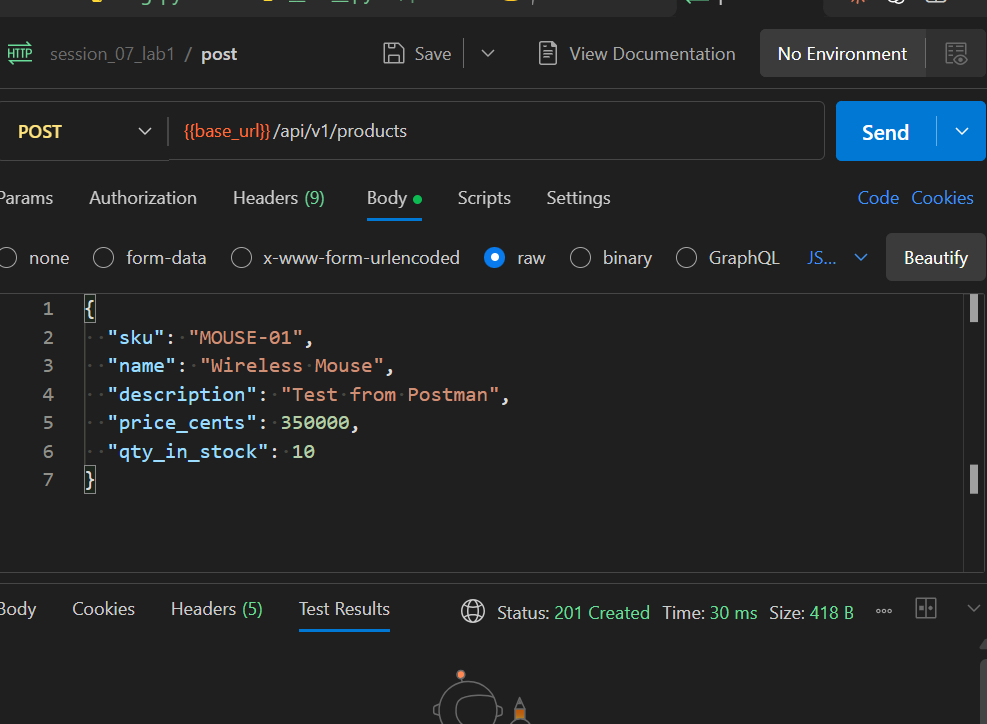
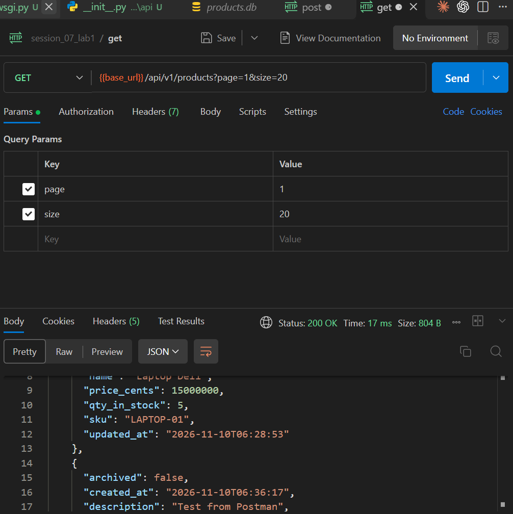
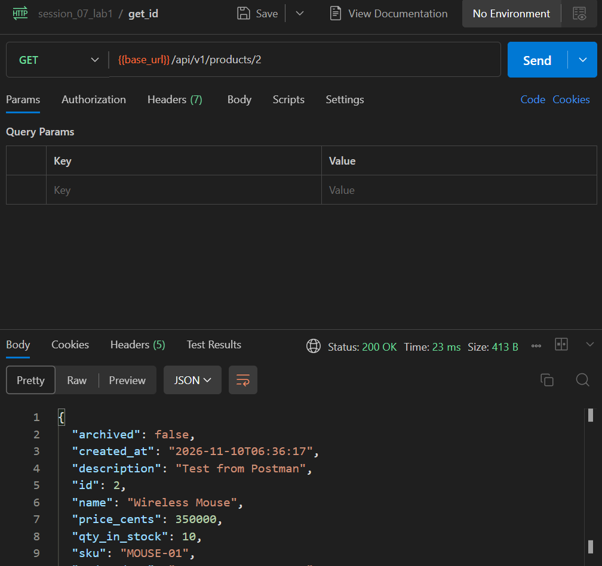
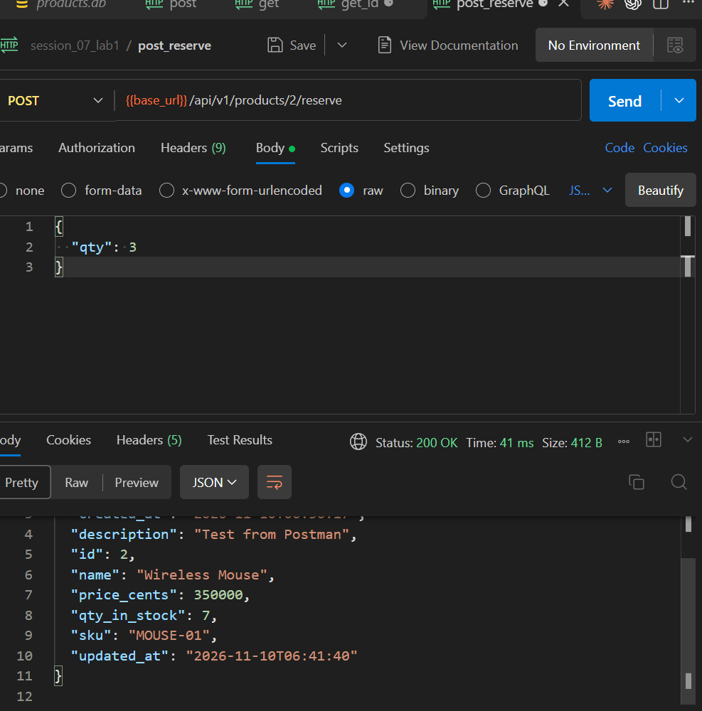
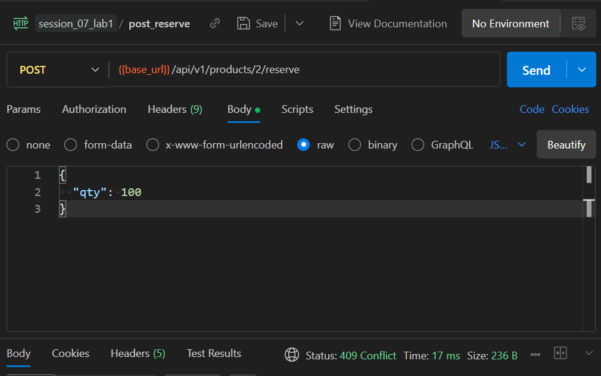
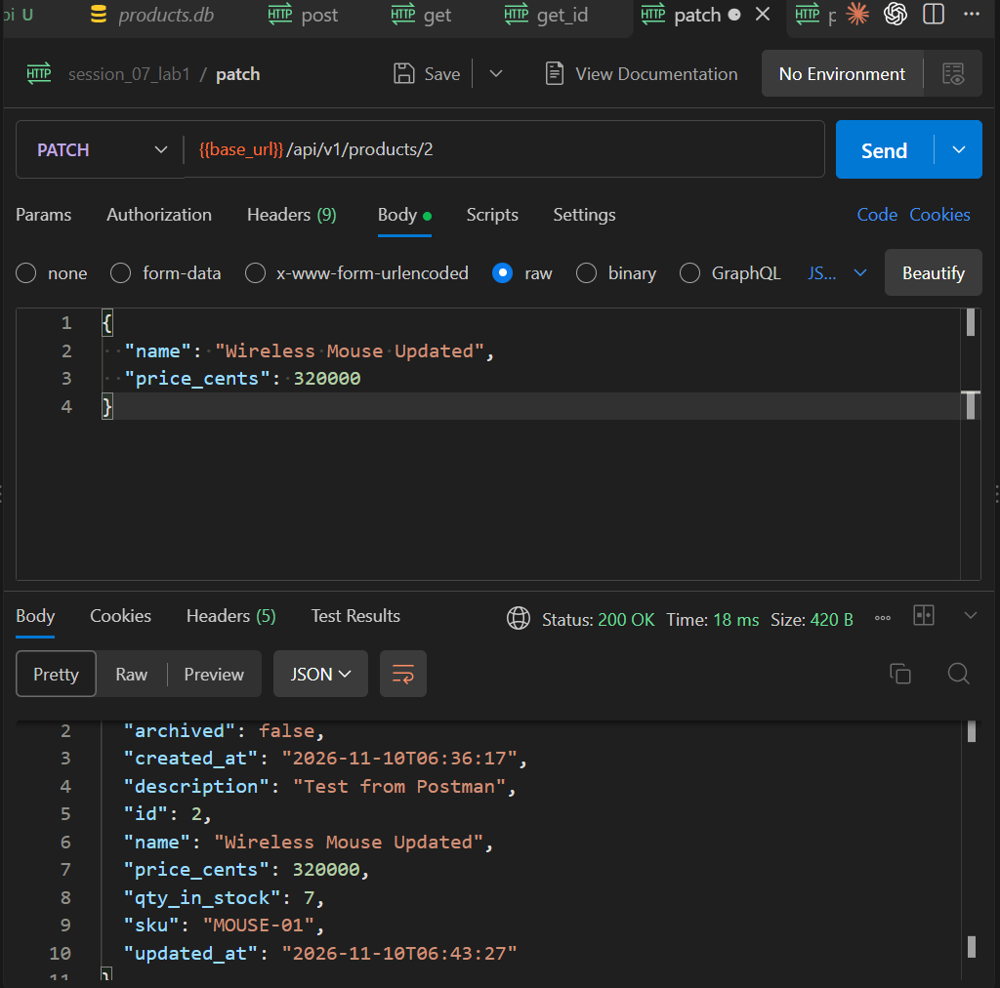
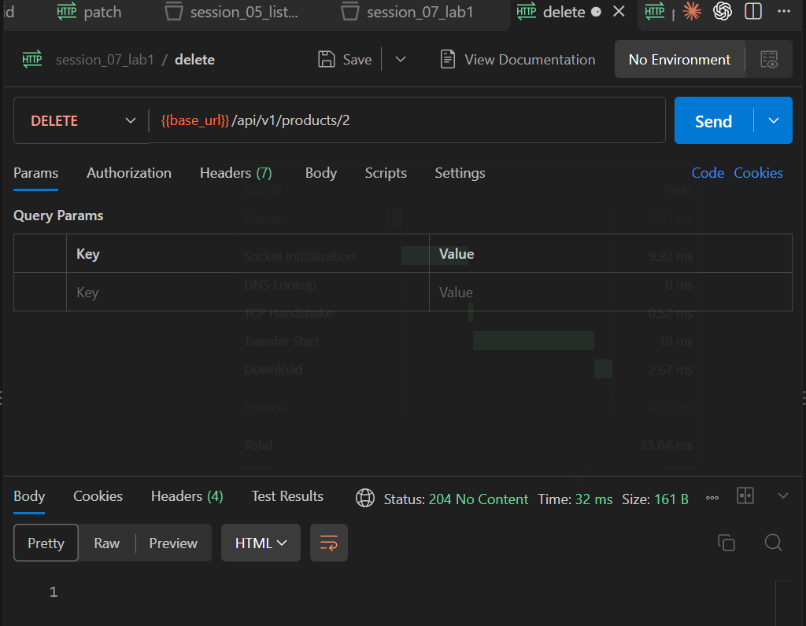
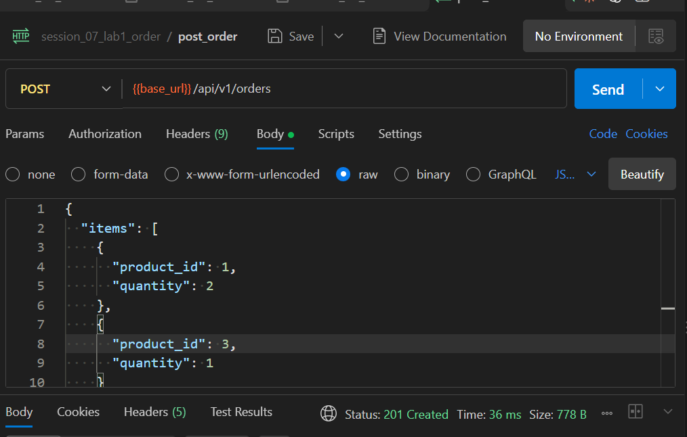
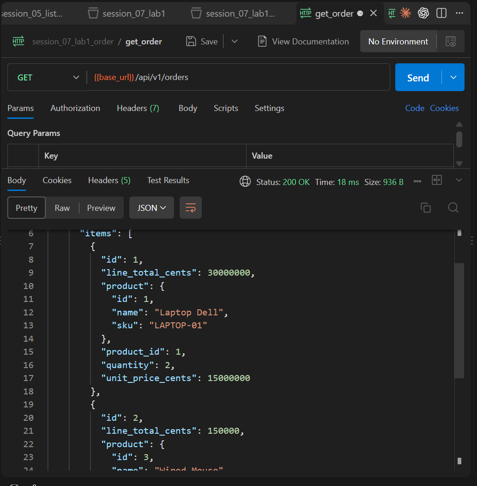
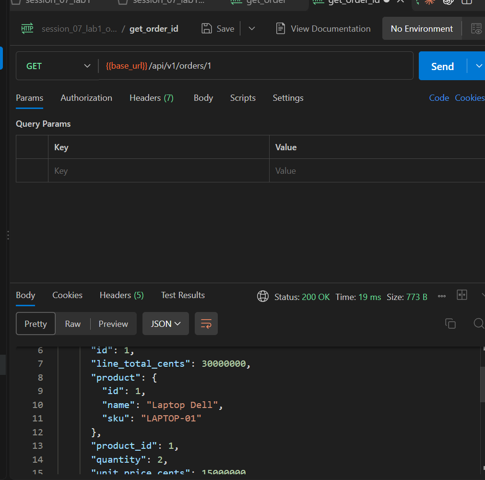

# Product API — SOA Lab 1

REST API xây dựng bằng Flask, SQLAlchemy và Marshmallow để quản lý sản phẩm, đặt trước tồn kho, đơn hàng và các sản phẩm thuộc đơn hàng.

## Chức năng chính

- CRUD Product với soft delete.
- Reserve sản phẩm và kiểm tra số lượng tồn kho.
- Tạo và truy vấn Order cùng các OrderItem liên kết với Product.
- Eager loading dữ liệu Order để hạn chế N+1 query.
- Database migration bằng Flask-Migrate/Alembic.
- Đóng gói service bằng Docker Compose với PostgreSQL.
- Tách riêng liveness check `/healthz` và readiness check `/ready`.
- Kiểm thử endpoint bằng pytest.

## Chạy bằng Docker

Tại thư mục `lab1`, chạy:

```powershell
docker compose up --build -d
```

API được cung cấp tại `http://127.0.0.1:5000`. Xem log hoặc dừng service bằng:

```powershell
docker compose logs -f api
docker compose down
```

## API endpoints

| Method | Endpoint | Mô tả |
| --- | --- | --- |
| `GET` | `/api/v1/products` | Lấy danh sách sản phẩm có phân trang |
| `GET` | `/api/v1/products/{id}` | Lấy một sản phẩm theo ID |
| `POST` | `/api/v1/products` | Tạo sản phẩm mới |
| `PATCH` | `/api/v1/products/{id}` | Cập nhật một phần thông tin sản phẩm |
| `DELETE` | `/api/v1/products/{id}` | Soft delete sản phẩm |
| `POST` | `/api/v1/products/{id}/reserve` | Giảm tồn kho khi reserve sản phẩm |
| `POST` | `/api/v1/orders` | Tạo đơn hàng cùng các OrderItem |
| `GET` | `/api/v1/orders` | Lấy danh sách đơn hàng |
| `GET` | `/api/v1/orders/{id}` | Lấy chi tiết một đơn hàng |
| `GET` | `/healthz` | Kiểm tra tiến trình API còn hoạt động |
| `GET` | `/ready` | Kiểm tra API và kết nối database sẵn sàng phục vụ |

## Kết quả kiểm thử API

### 1. Tạo sản phẩm



*Gửi `POST /api/v1/products` với dữ liệu sản phẩm hợp lệ và nhận phản hồi `201 Created`.*

### 2. Lấy danh sách sản phẩm



*Gửi `GET /api/v1/products?page=1&size=20` để lấy danh sách sản phẩm có phân trang, phản hồi `200 OK`.*

### 3. Lấy chi tiết sản phẩm



*Gửi `GET /api/v1/products/2` để lấy thông tin chi tiết của sản phẩm theo ID.*

### 4. Reserve sản phẩm thành công



*Reserve 3 sản phẩm bằng `POST /api/v1/products/2/reserve`; số lượng tồn kho giảm từ 10 xuống 7.*

### 5. Reserve vượt quá tồn kho



*Reserve số lượng lớn hơn tồn kho hiện có và nhận phản hồi `409 Conflict`.*

### 6. Cập nhật sản phẩm



*Gửi `PATCH /api/v1/products/2` để cập nhật tên và giá sản phẩm, phản hồi `200 OK`.*

### 7. Xóa mềm sản phẩm



*Gửi `DELETE /api/v1/products/2` để đánh dấu sản phẩm đã lưu trữ và nhận phản hồi `204 No Content`.*

### 8. Tạo đơn hàng



*Gửi `POST /api/v1/orders` với nhiều Product để tạo Order cùng các OrderItem, phản hồi `201 Created`.*

### 9. Lấy danh sách đơn hàng



*Gửi `GET /api/v1/orders` để lấy các đơn hàng cùng thông tin Product được eager load trong từng OrderItem.*

### 10. Lấy chi tiết đơn hàng



*Gửi `GET /api/v1/orders/1` để lấy chi tiết một Order cùng danh sách OrderItem và Product tương ứng.*

## Chạy kiểm thử

Kích hoạt virtual environment chung của thư mục `SOA`, cài dependency phát triển và chạy pytest:

```powershell
cd G:\SOA
.\.venv\Scripts\Activate.ps1
cd .\api_session_07\lab1
python -m pip install -e ".[dev]"
python -m pytest -v
```
