# Session 08 Evidence — API Testing & Quality Assurance

Tài liệu này ghi lại bằng chứng thực hiện các bài kiểm thử OpenAPI, Postman và Newman trong Session 08.

## Lab 2 — OpenAPI Linting with Spectral

Phần này ghi lại quá trình dùng Spectral để phát hiện và sửa các lỗi cố ý trong `openapi.yaml`, sau đó bổ sung custom rule kiểm tra response `200` có schema không rỗng.

### 1. Phát hiện ba lỗi ban đầu

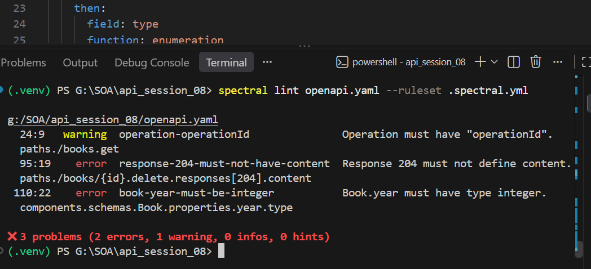

*Spectral phát hiện `GET /books` thiếu `operationId`, response `204` khai báo `content`, và `Book.year` dùng sai kiểu `string` thay vì `integer`.*

### 2. Sửa các lỗi trong OpenAPI

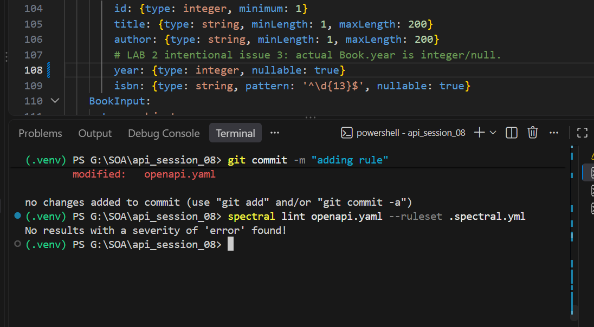

*Sau khi thêm `operationId`, loại bỏ body của response `204` và đổi `Book.year` thành `integer`, Spectral không còn báo lỗi.*

### 3. Bổ sung custom rule


*Custom rule `response-200-must-have-non-empty-schema` yêu cầu mọi JSON response `200` phải khai báo schema không rỗng; sau khi sửa thụt lề YAML, lần lint cuối đã thành công.*

### Kết quả

Lệnh kiểm tra:

```powershell
spectral lint openapi.yaml --ruleset .spectral.yml
```

Kết quả cuối:

```text
No results with a severity of 'error' found!
```

## Lab 3 — Postman Collection và Newman

Phần này ghi lại flow kiểm thử Books API gồm năm happy-path request, hai error-path request và lần chạy tự động bằng Newman.

### 1. GET danh sách sách

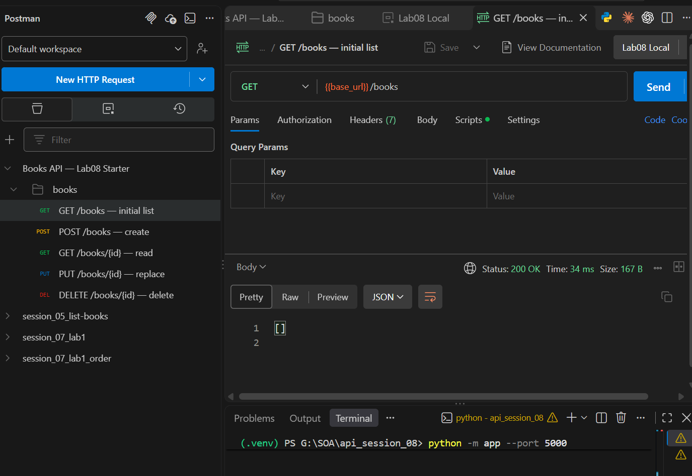

*Request `GET /books` sử dụng environment `Lab08 Local`, trả về `200 OK` và một mảng JSON rỗng khi cơ sở dữ liệu chưa có sách.*

### 2. POST tạo sách

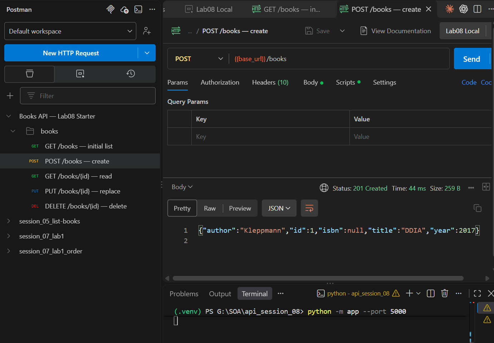

*Request `POST /books` tạo sách DDIA thành công với status `201 Created`; response chứa `id`, `title`, `author`, `year` và `isbn`.*

### 3. GET sách theo ID

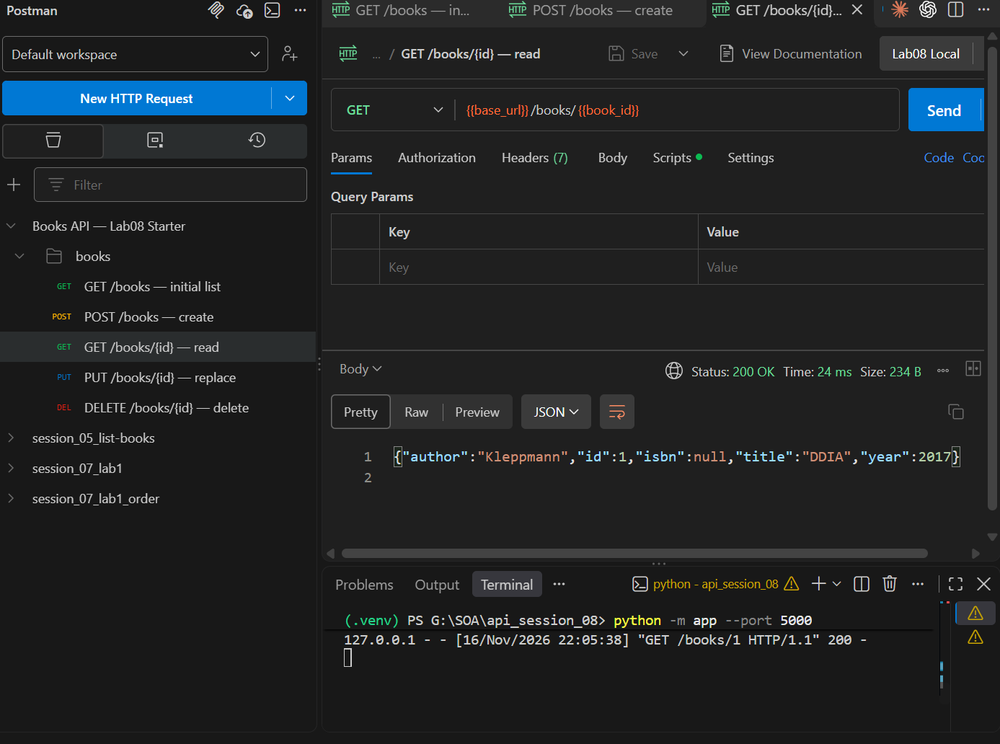

*Request `GET /books/{{book_id}}` dùng collection variable được lưu từ bước tạo sách và trả về đúng tài nguyên với status `200 OK`.*

### 4. PUT cập nhật sách

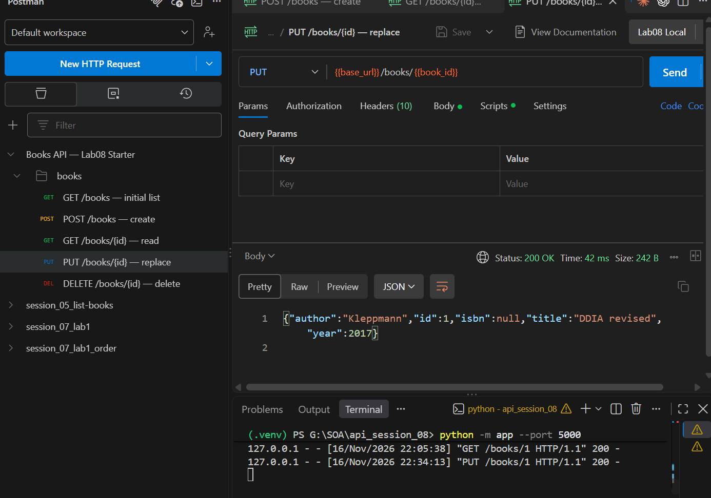

*Request `PUT /books/{{book_id}}` cập nhật tiêu đề thành `DDIA revised`; API trả về `200 OK` cùng dữ liệu sau cập nhật.*

### 5. DELETE xóa sách

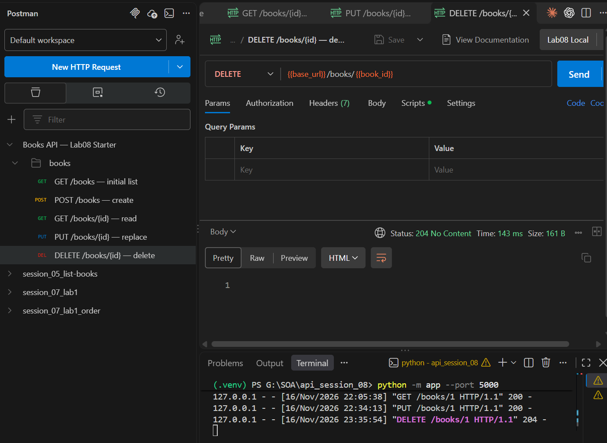

*Request `DELETE /books/{{book_id}}` xóa tài nguyên thành công với status `204 No Content` và không có response body.*

### 6. Error case — POST thiếu title

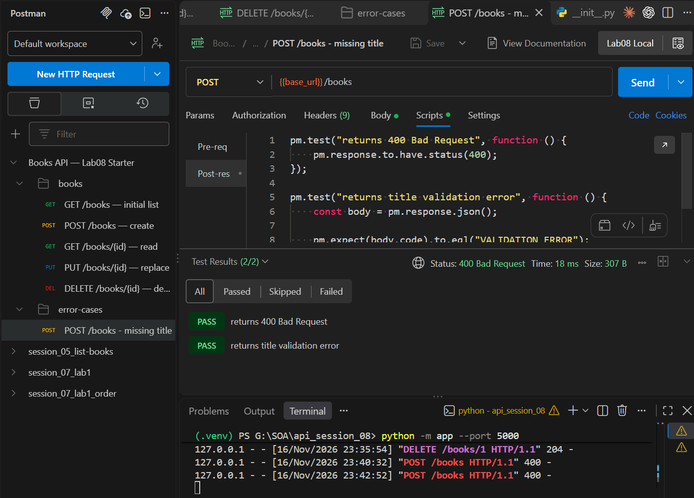

*Request thiếu trường bắt buộc `title` trả về `400 Bad Request`; cả hai assertion kiểm tra status và validation error đều pass.*

### 7. Error case — GET ID không tồn tại

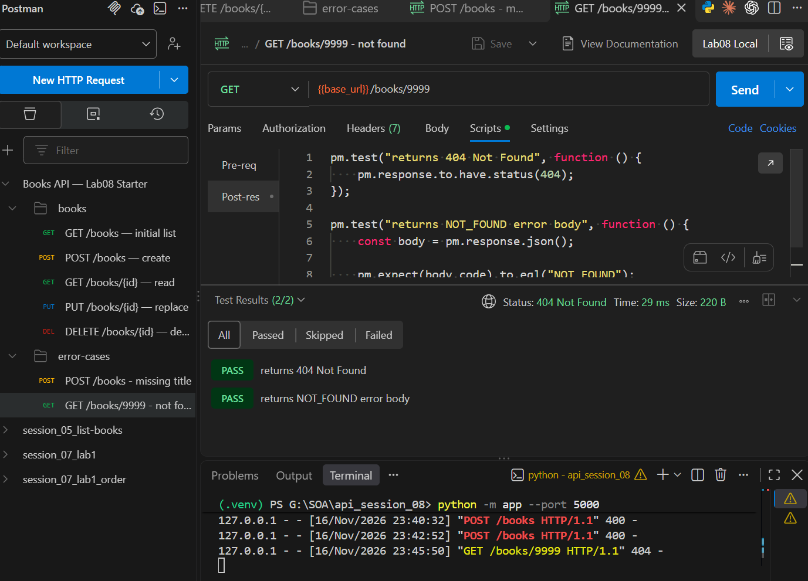

*Request `GET /books/9999` trả về `404 Not Found`; hai assertion xác nhận status và error body `NOT_FOUND` đều pass.*

### 8. Chạy toàn bộ collection

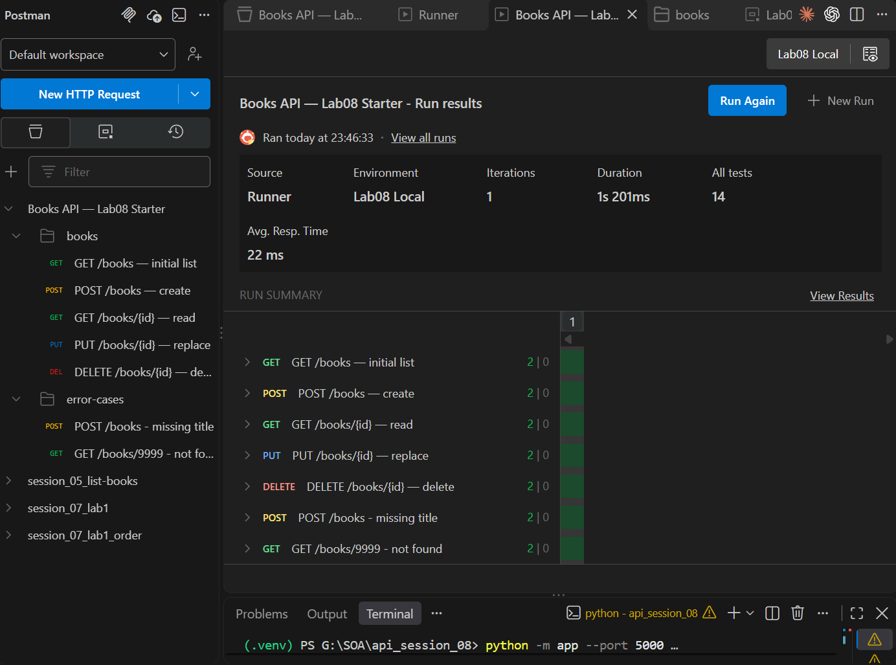

*Collection Runner thực thi đủ bảy request trong một iteration với tổng cộng 14 test; mỗi request đều có hai assertion pass và không có assertion thất bại.*

### 9. Chạy tự động bằng Newman

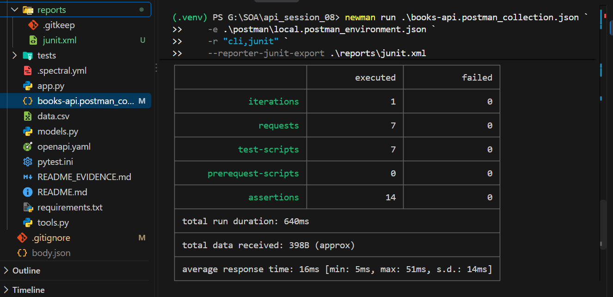

*Newman thực thi một iteration gồm bảy request, bảy test script và 14 assertion với `0` failure, đồng thời xuất báo cáo JUnit tại `reports/junit.xml`.*

Lệnh chạy:

```powershell
newman run .\books-api.postman_collection.json `
    -e .\postman\local.postman_environment.json `
    -r "cli,junit" `
    --reporter-junit-export .\reports\junit.xml
```
