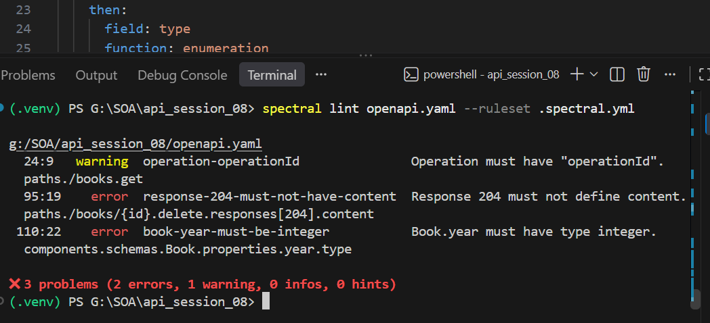
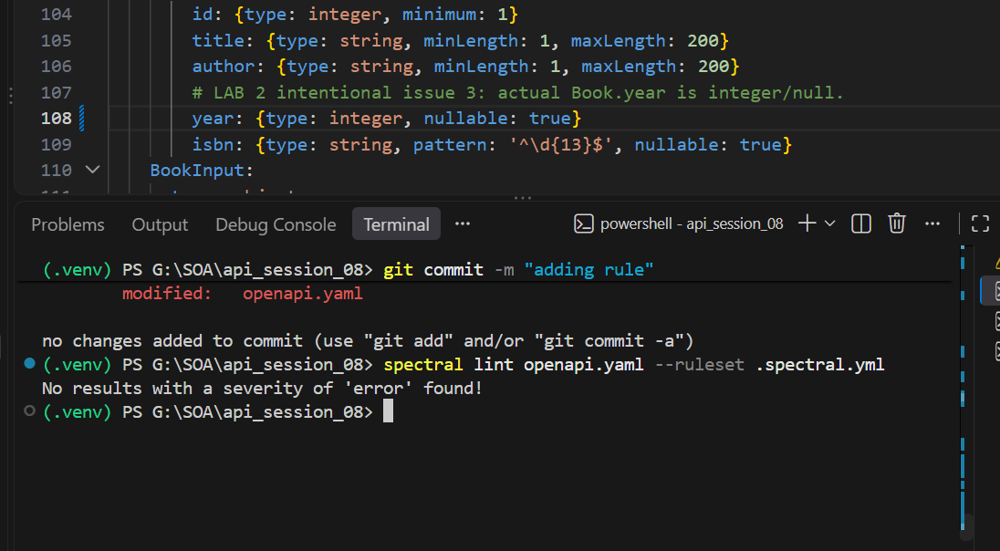

# Lab 2 Evidence — OpenAPI Linting with Spectral

Tài liệu này ghi lại quá trình dùng Spectral để phát hiện và sửa các lỗi cố ý trong `openapi.yaml`, sau đó bổ sung custom rule kiểm tra response `200` có schema không rỗng.

## 1. Phát hiện ba lỗi ban đầu



*Spectral phát hiện `GET /books` thiếu `operationId`, response `204` khai báo `content`, và `Book.year` dùng sai kiểu `string` thay vì `integer`.*

## 2. Sửa các lỗi trong OpenAPI



*Sau khi thêm `operationId`, loại bỏ body của response `204` và đổi `Book.year` thành `integer`, Spectral không còn báo lỗi.*

## 3. Bổ sung custom rule


*Custom rule `response-200-must-have-non-empty-schema` yêu cầu mọi JSON response `200` phải khai báo schema không rỗng; sau khi sửa thụt lề YAML, lần lint cuối đã thành công.*

## Kết quả

Lệnh kiểm tra:

```powershell
spectral lint openapi.yaml --ruleset .spectral.yml
```

Kết quả cuối:

```text
No results with a severity of 'error' found!
```
