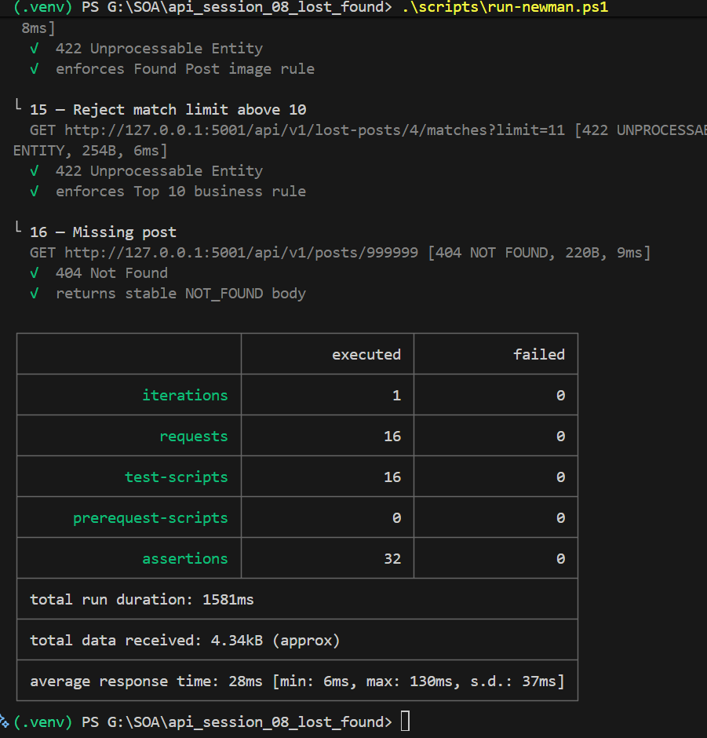

# Evidence — Session 08 Lost & Found

## Postman collection chạy bằng Newman

Lệnh thực thi:

```powershell
.\scripts\run-newman.ps1
```



Collection kiểm thử luồng chính và các trường hợp lỗi của Lost & Found API. Kết quả: **16/16 request** và **32/32 assertion** đều thành công, không có test thất bại; thời gian phản hồi trung bình là **28 ms**.

## Locust load test cho endpoint matching

Endpoint được kiểm thử tải:

```http
GET /api/v1/lost-posts/{id}/matches?limit=5|10
```

| Scenario | Virtual users | p95 | Failure rate | RPS | Kết quả SLO |
|---|---:|---:|---:|---:|---|
| A — baseline | 10 | 24 ms | 0% | 9.21 | Đạt |
| B — normal load | 50 | 48 ms | 0% | 45.26 | Đạt |
| C — spike | 200 | 2,600 ms | 0% | 80.85 | Không đạt p95 |

Report HTML: [Scenario A](./reports/A.html), [Scenario B](./reports/B.html),
[Scenario C](./reports/C.html). Phân tích và SLO đề xuất được trình bày trong
[performance/analysis.md](./performance/analysis.md).

