# KẾT QUẢ BÀI 9 - API VERSIONING

README này tổng hợp evidence chạy thử bốn bài thực hành về API versioning và lifecycle management bằng Flask.

## Lab 1 - URI Path Versioning với Flask Blueprint

### GET user bằng API v1

**Evidence:** Request `GET /api/v1/users/1` thành công. API v1 trả schema cũ với trường `full_name`, chứng minh Blueprint v1 được mount và xử lý độc lập.

### GET cùng user bằng API v2

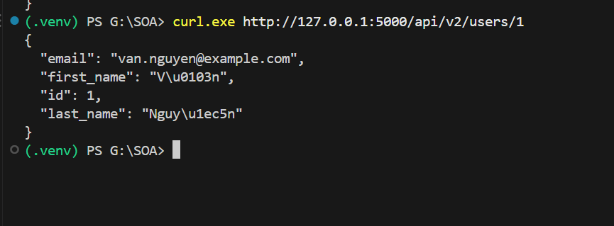

**Evidence:** Request `GET /api/v2/users/1` thành công. API v2 trả schema mới với hai trường `first_name` và `last_name`, trong khi vẫn sử dụng cùng nguồn dữ liệu user.

### GET user không tồn tại

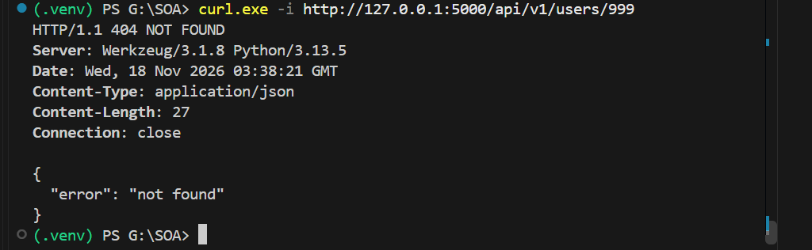

**Evidence:** Request user ID `999` trả lỗi `404 Not Found`, chứng minh endpoint xử lý đúng trường hợp không tìm thấy dữ liệu.

### Tạo user mới bằng API v2

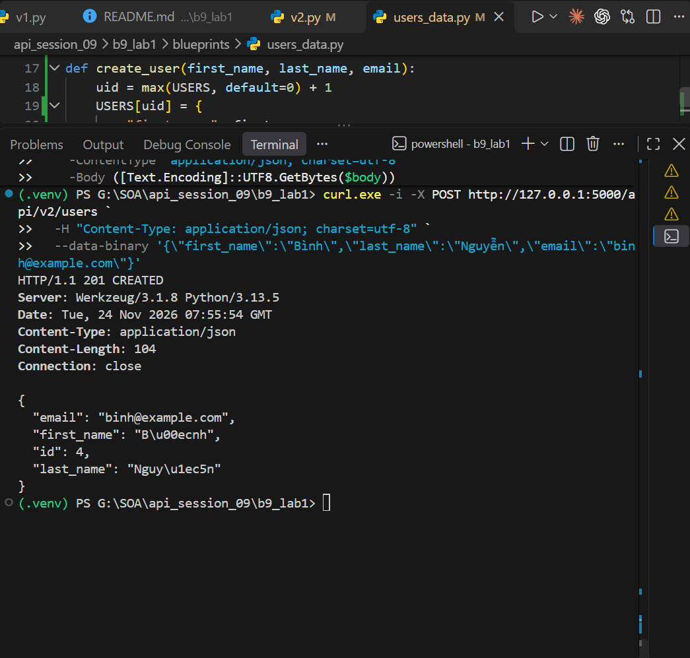

**Evidence:** Request `POST /api/v2/users` trả `201 Created`. Response chứa user mới với `id`, `first_name`, `last_name` và `email`, chứng minh API v2 nhận JSON body và tạo dữ liệu thành công.

### Sunset header cho API v1

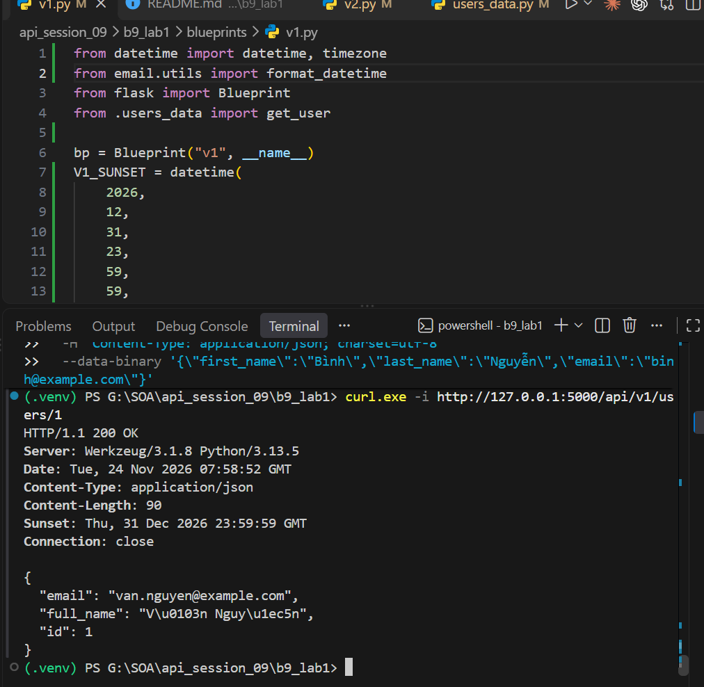

**Evidence:** Request `GET /api/v1/users/1` vẫn trả `200 OK`, đồng thời response có header `Sunset: Thu, 31 Dec 2026 23:59:59 GMT`. Header này thông báo trước thời điểm API v1 dự kiến ngừng hoạt động.

## Lab 2 - Header Versioning

### Không truyền version - mặc định dùng v2

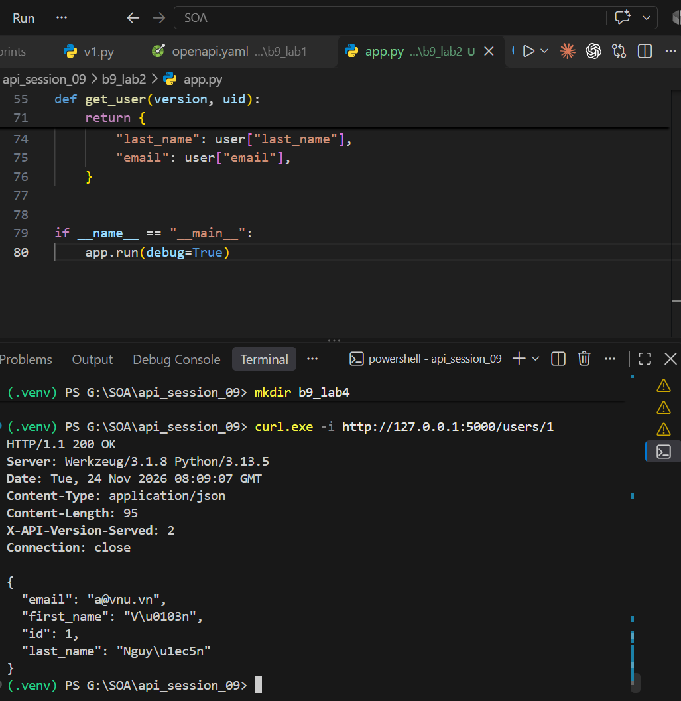

**Evidence:** Request `GET /users/1` không truyền `X-API-Version` nhưng response có header `X-API-Version-Served: 2`. Body sử dụng schema v2 với `first_name`, `last_name` và `email`.

### Chọn API v1 bằng header

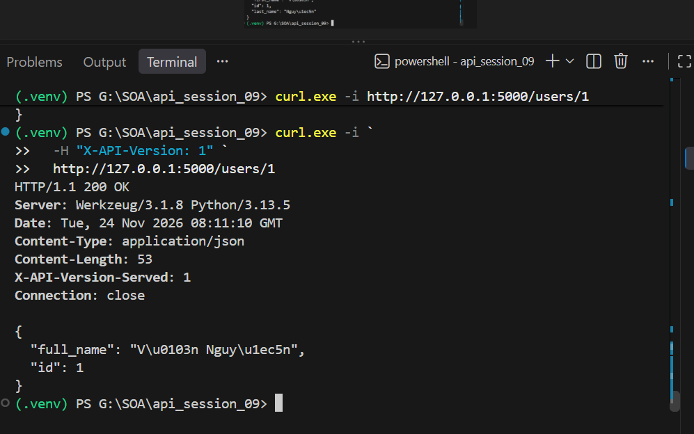

**Evidence:** Khi gửi `X-API-Version: 1`, response có `X-API-Version-Served: 1` và trả schema v1 với trường `full_name`.

### Chọn version theo ngày

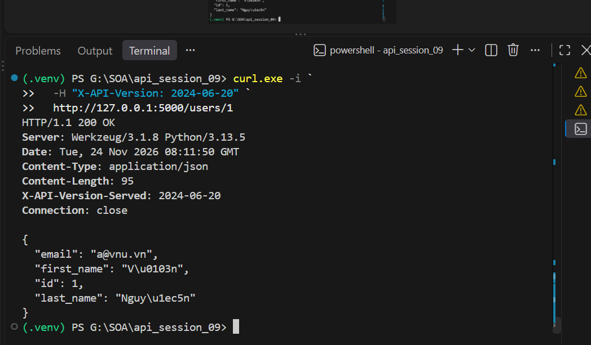

**Evidence:** Khi gửi `X-API-Version: 2024-06-20`, server xác nhận version qua header `X-API-Version-Served: 2024-06-20` và trả schema mới. Điều này minh họa date-based header versioning.

## Lab 3 - Sunset Middleware

### Endpoint v1 đang trong giai đoạn deprecation

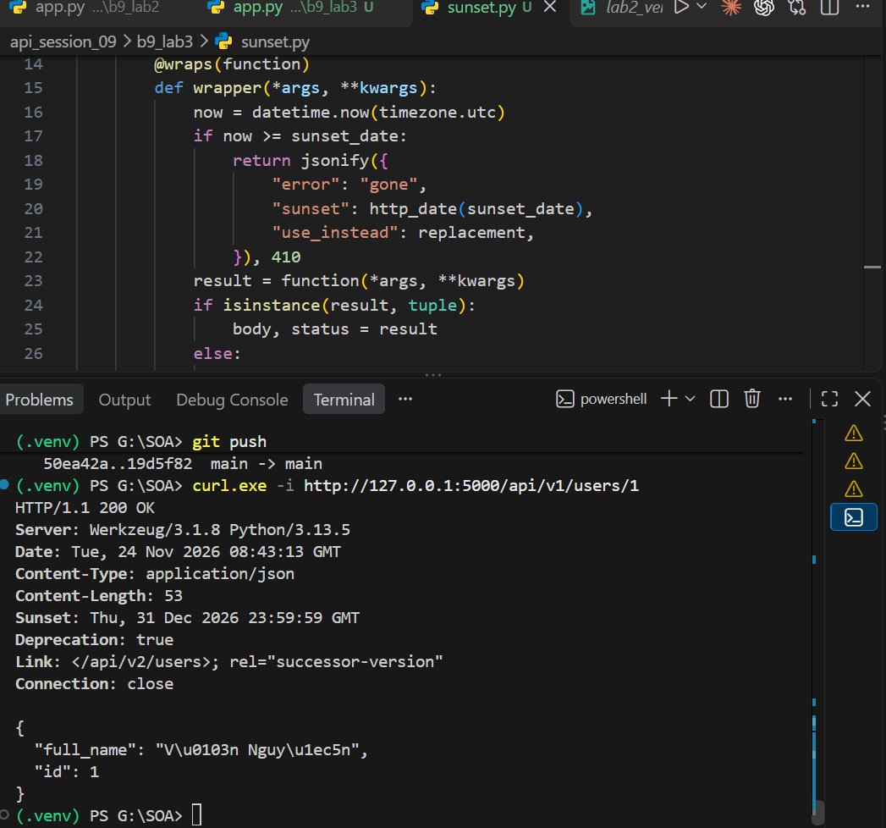

**Evidence:** Trước thời điểm sunset, endpoint v1 vẫn trả `200 OK` nhưng kèm ba header:

- `Sunset`: thời điểm API sẽ ngừng hoạt động.
- `Deprecation: true`: đánh dấu API đã bị deprecated.
- `Link`: chỉ tới successor version `/api/v2/users`.

### Endpoint v1 sau thời điểm sunset

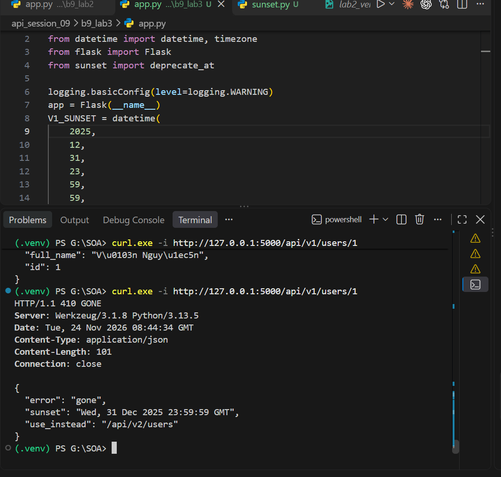

**Evidence:** Khi đặt thời điểm sunset trong quá khứ, request tới API v1 trả `410 Gone`. Response cung cấp thời điểm sunset và trường `use_instead` để hướng client sang API v2.

## Lab 4 - Blue-Green Routing

### Routing theo cohort beta

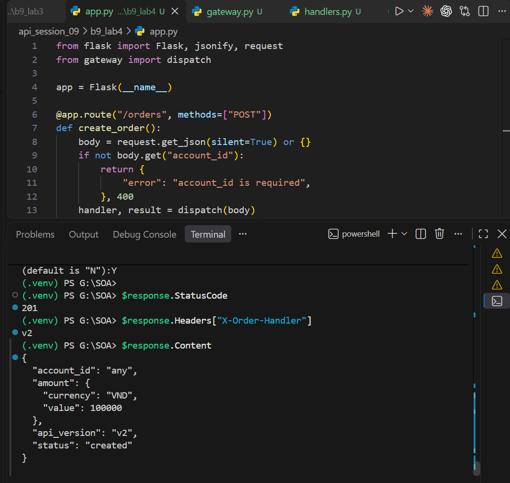

**Evidence:** Request thuộc cohort `beta` được route thẳng tới handler v2. Response trả `201`, header `X-Order-Handler: v2` và body sử dụng schema order v2.

### Routing theo account allow-list

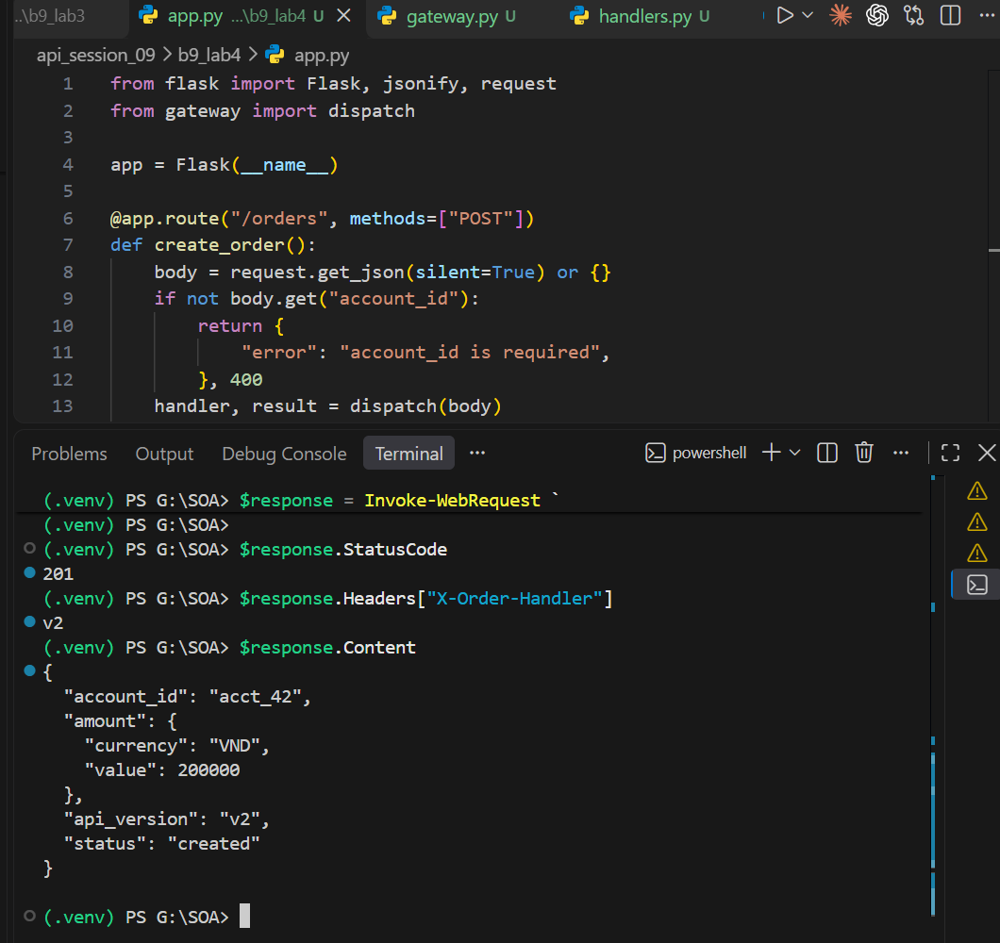

**Evidence:** Account `acct_42` nằm trong allow-list nên luôn được route tới v2. Header `X-Order-Handler: v2` xác nhận handler đã phục vụ request.

### Routing theo hash bucket

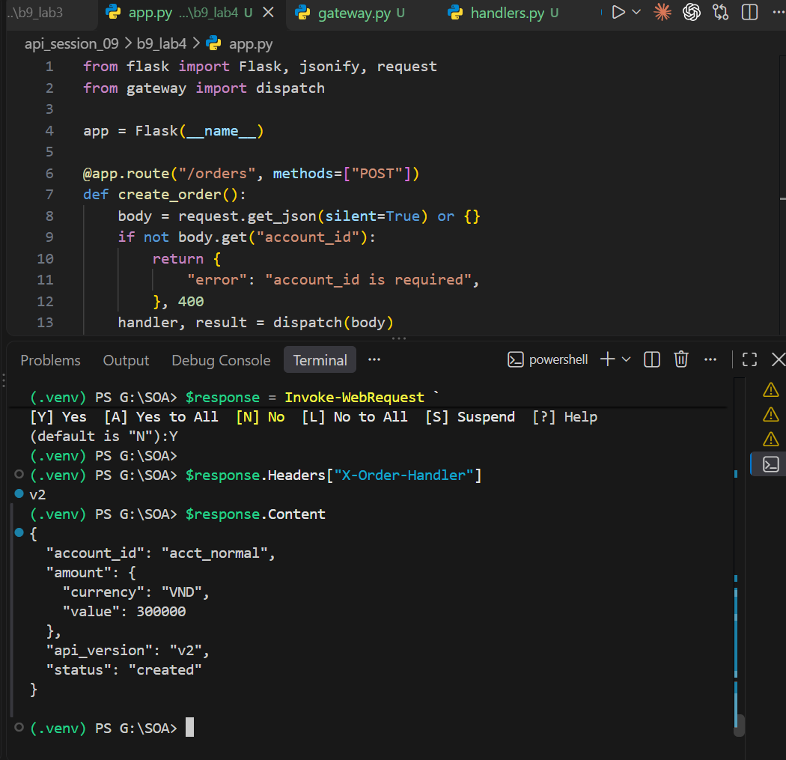

**Evidence:** Account thông thường không thuộc cohort hoặc allow-list được gateway phân bucket bằng hash. Trong cấu hình tại thời điểm test, account được chọn vào v2 và response có `X-Order-Handler: v2`.

## Kết luận

Các evidence xác nhận bốn cơ chế đã hoạt động:

1. URI Path Versioning tách riêng URL và response schema của v1/v2.
2. Header Versioning chọn version trên cùng một URL.
3. Sunset Middleware cảnh báo deprecation và trả `410 Gone` sau deadline.
4. Blue-Green Routing chuyển traffic sang v2 theo cohort, allow-list và hash bucket.
